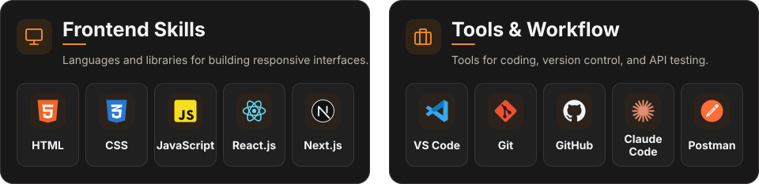

<picture>
  <source media="(max-width: 767px)" srcset="https://raw.githubusercontent.com/muhammadsharjeel039-dotcom/muhammadsharjeel039-dotcom/3ab5a478f407558d66a132f2032261d5f227ba01/assets/portfolio-skills-tools-mobile.svg">
  
</picture>

I’m a frontend developer building responsive dashboards, API-driven web apps, and e-commerce storefronts. I’m pursuing a **BS in Information Technology** at Virtual University of Pakistan and open to **Frontend Developer** and **Frontend Engineer** roles.

 &nbsp;  &nbsp; 

## Featured work

**Apex Smart Works · Internship.** Contributed to the frontend of a responsive company website with dedicated pages for web development, digital marketing, and SEO services.

**Geniemerce · E-commerce.** Worked on the storefront and product catalog for costume jewelry and handmade crochet clothing, organized by category for easier browsing.

**PulseTrade · Stock market simulator.** Brings Pakistan Stock Exchange workflows into web and Android interfaces, with a searchable watchlist, simulated market and limit orders, alerts, and portfolio tracking.

### More projects

| Project | What it does |
| :--- | :--- |
| [**Weather Forecast App**](https://github.com/muhammadsharjeel039-dotcom/Weather-Forecast-App) | Searches by location and displays forecast data from a weather API. |
| [**Currency Converter**](https://github.com/muhammadsharjeel039-dotcom/Currency-Converter) | Converts a selected currency pair using current exchange-rate data. |
| **Dispose It** | Supports product browsing, checkout, and bulk-order inquiries for a WordPress storefront. |

## How I build

I also work with **Vite, TypeScript, and Vercel** for web projects and **WordPress, Elementor, and WooCommerce** for storefronts.

I build interfaces from reusable components, keep data fetching separate from presentation, and check how loading states, forms, and navigation behave across screen sizes.

## Contact

For frontend roles or project inquiries, [connect on LinkedIn](https://www.linkedin.com/in/muhammad-sharjeel-327705332/) or [send me an email](mailto:muhammadsharjeel039@gmail.com).
