I’m a frontend developer and BS Information Technology student at Virtual University of Pakistan. I build responsive websites and interactive interfaces, with project work spanning JavaScript apps, dashboards, and WordPress storefronts.

[**Connect on LinkedIn**](https://www.linkedin.com/in/muhammad-sharjeel-327705332/) · [**Browse my repositories**](https://github.com/muhammadsharjeel039-dotcom?tab=repositories) · [**Email me**](mailto:muhammadsharjeel039@gmail.com)

## Selected projects

| Project | What it shows |
| --- | --- |
| [**Weather Forecast App**](https://github.com/muhammadsharjeel039-dotcom/Weather-Forecast-App) | An API-driven weather interface with location search, forecasts, and responsive layouts. |
| [**Currency Converter**](https://github.com/muhammadsharjeel039-dotcom/Currency-Converter) | An exchange-rate interface that fetches current rates and calculates conversions. |
| [**Netflix Landing Page Clone**](https://github.com/muhammadsharjeel039-dotcom/Netflix-Landing-Page-Clone) | A layout exercise in responsive HTML and CSS. |

## Website work

- **[Apex Smart Works](https://apexsmartworks.com/)** — Contributed to a business website with dedicated pages for web development, digital marketing, and SEO services.
- **[Geniemerce](https://geniemerce.com/)** — Worked on a WordPress storefront and product catalog for a jewelry and crochet shop.

## Tech stack

| Area | Tools |
| --- | --- |
| Frontend | React, JavaScript, HTML, CSS, Vite |
| Additional tools | TypeScript, Next.js, Tailwind CSS |
| E-commerce | WordPress, Elementor, WooCommerce |
| Workflow | Git, GitHub, VS Code, Vercel |

**Open to Frontend Developer and Frontend Engineer roles.**
